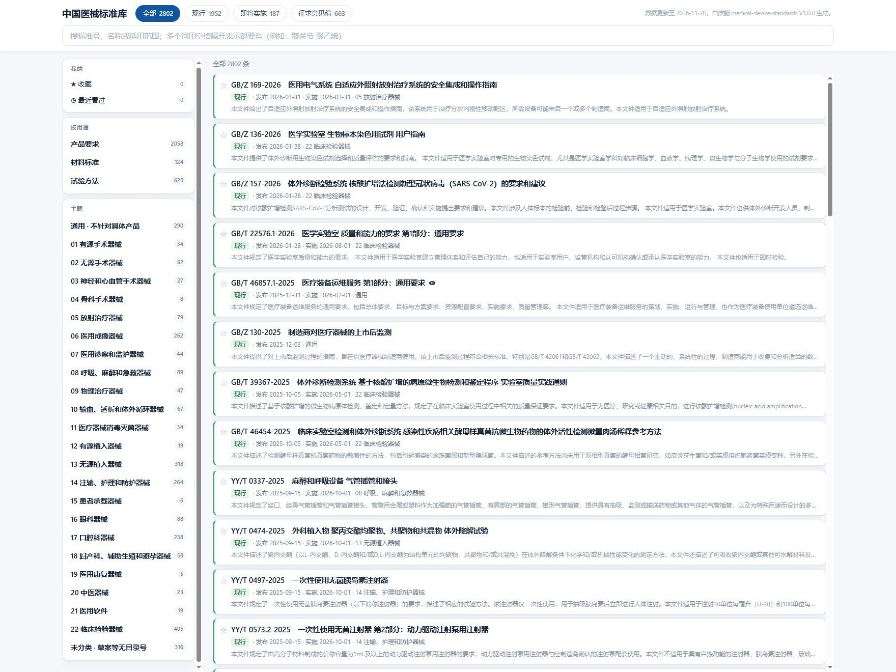

# 中国医械标准库

*China medical device standards library (AI agent skill)*

这是给 AI 助手用的**技能**（Skill），不是软件 —— 没有安装包、没有界面、不用敲命令。

装好之后在对话框里说一句：

> 更新标准库

它就会去标管中心、行标备案库抓现行有效的国标（GB / GB-T / GB-Z）和行标（YY / YY-T / YY-Z），生成一个能离线检索的单文件网页，每条都带官方页面链接。

按 2026-11-24 那次实抓，一全套约 **2,800 条**：现行约 1,950、即将实施约 190、征求意见中约 660。跑一次拿到的是当时的最新数据。

## 长什么样

**标准库页面**（示例）

页面左栏是筛选（状态、按用途、按材料、主题），中间是标准列表，每条显示标准号、名称、状态标签和官方页链接。

---

## 一条记录是什么

**一个标准 = 标准号 + 名称 + 状态 + 官方页链接**，不是一篇公告。同一标准号的历史版本串成一条线索：现行是哪版、被谁替过。

已废止的不入库。

## 怎么用（两步）

### 第一步：装给 AI 助手

把这个文件夹（或它的路径）交给能跑代码的助手（Claude Code、Codex、Hermes 这类），说一句：

> 装一下这个技能

助手会读 `SKILL.md`，把它复制进自己的技能目录。装一次就行，以后一直在。

也可以直接把文件夹拖进对话框，比手打路径省事。

### 第二步：用

装好之后，在对话框里说：

> 更新标准库

它就会跑 `python run.py`——自检、抓数据、生成页面。

**不想装也能用**：双击文件夹里的 `启动.bat`，效果一样，只是少了「以后说一句就能自动想起来」这个便利。

第一次约 10 分钟（实测 9 分 41 秒，其中补每条标准的详情占 5 分钟）。之后看页面不用联网，双击生成好的 html 就行。

## 运行条件

三样，缺一不可：

| 条件 | 说明 |
|---|---|
| **Python 3.8 以上** | 唯一必须装的东西。没有就去 python.org 下载，安装时**勾选 Add Python to PATH**（这一步漏了就会提示找不到 Python） |
| **能联网** | 拉数据要访问三个官方站：标管中心目录库、行标备案库、征求意见栏目 |
| **浏览器** | 看生成好的页面用，系统自带的就行 |

**不需要装任何第三方包。** 脚本只用了 Python 自带的库（`urllib`、`json`、`re`、`concurrent.futures` 这些），没有 `requests`、没有 `pandas`、没有浏览器内核。装包不是可选项，`启动.bat` 里也不会多一步 pip。

Windows：双击 `启动.bat`，它会自己找 `python` 或 `py`。
Mac / Linux：`python3 run.py`（`.bat` 用不了）。

解压到哪都行，路径带中文没问题（实测过）。

## 页面能做什么

- 搜标准号、名称、材料、用途（YY 0033 / 胶原蛋白 / 试验方法）
- 命中会标出来，两种颜色区分命中的是标准号还是名称
- 按用途筛：产品要求 / 材料标准 / 试验方法
- 按材料种类筛：金属 / 高分子 / 陶瓷与无机 / 天然与生物源 / 其他
- 按状态筛：现行 / 即将实施 / 征求意见中
- 条件可叠加：「试验方法 + 金属」只看金属类的试验方法标准
- 点标题打开官方页面看原文（这一步要联网）

## 只收国标和行标

不收团体标准。这是官方年报的对账口径——加进团标，就没法跟官方数字核对了。

数据源：标管中心标准目录库、全国标准信息平台行标备案、标管中心征求意见。

## 说明

数据均来自官方公开栏目，本仓库只做汇总与索引，标准正文以官方发布为准。

本项目为个人整理，**与药品监督管理部门无隶属、委托或授权关系**。

代码以 MIT 许可发布（见 `LICENSE`）。

---

  

